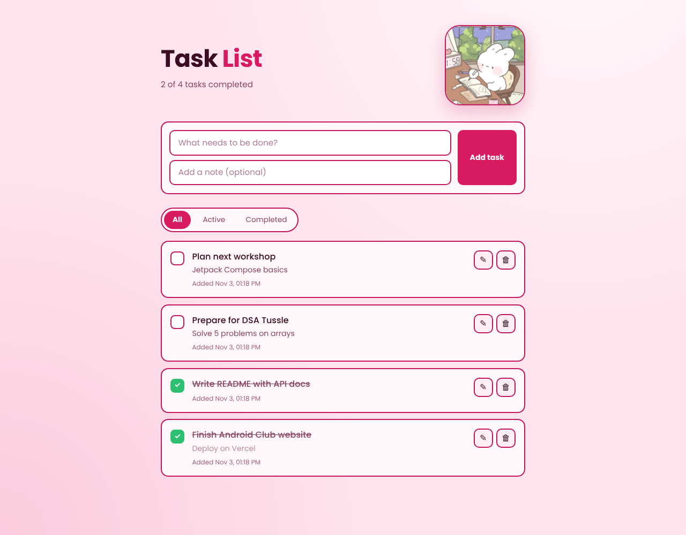
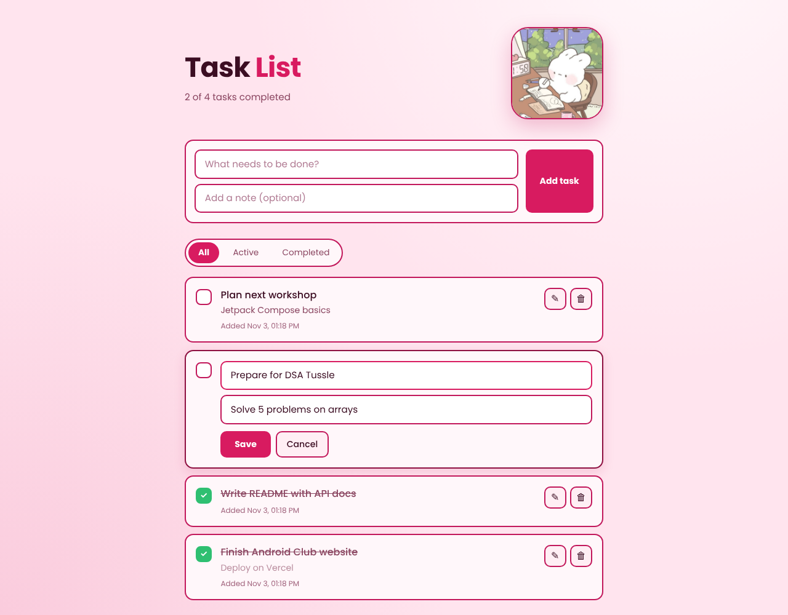
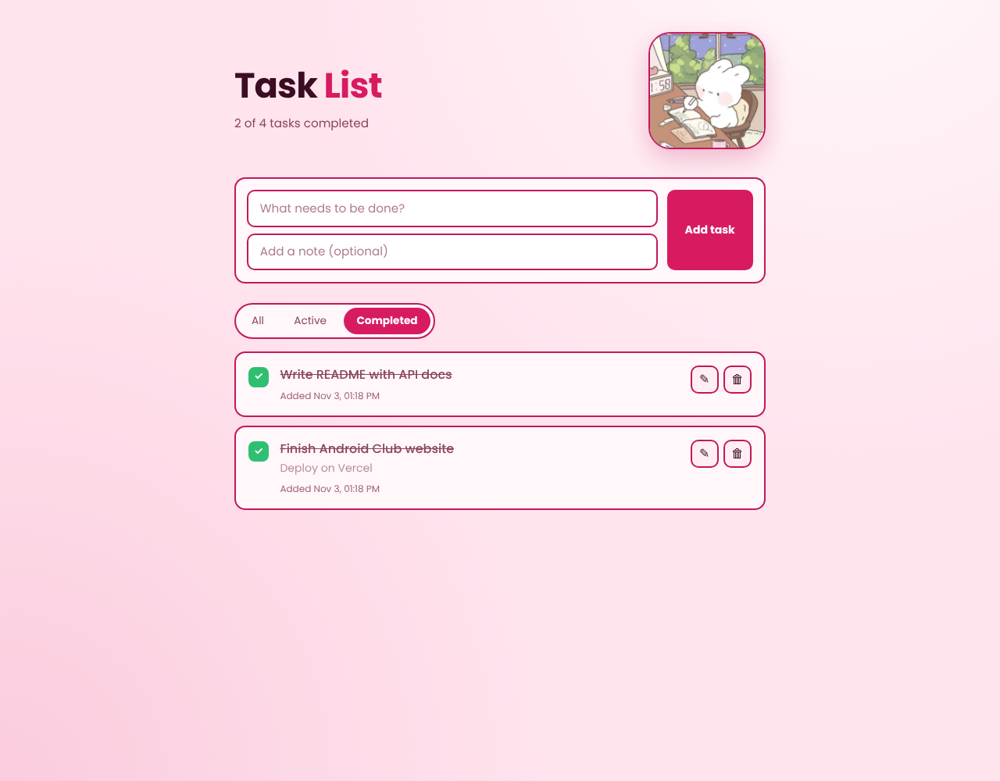
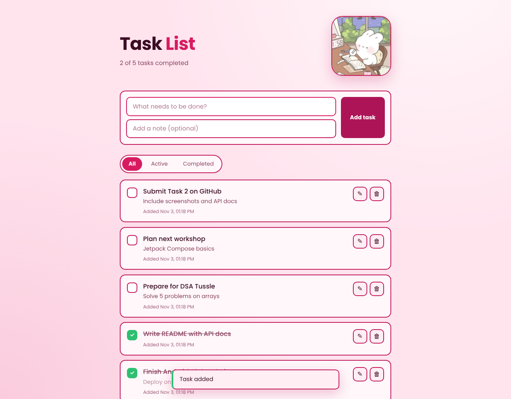
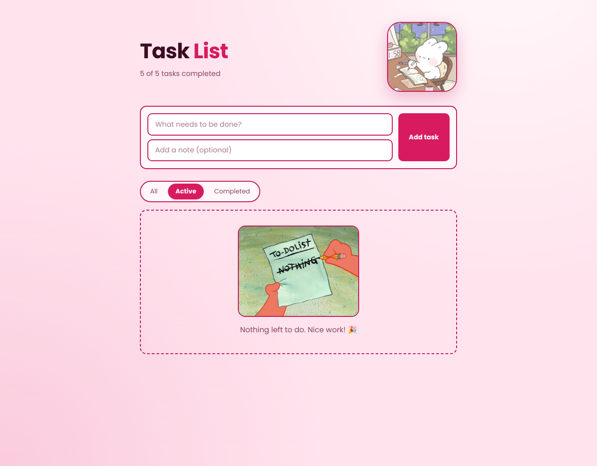
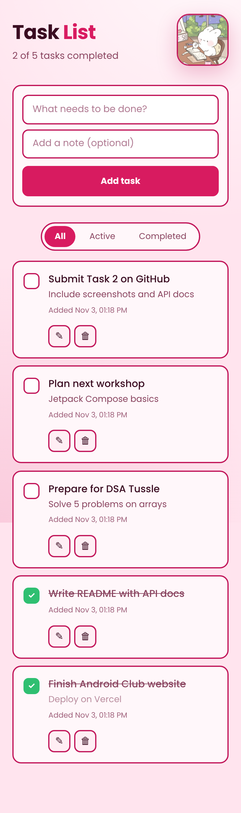

# Task List Application

A full-stack task list app. Users can **add, edit, delete** tasks and **mark them complete / incomplete**.

- **Backend:** Node.js with a RESTful JSON API (CRUD), input validation and proper error handling
- **Database:** SQLite (via Node's built-in `node:sqlite` module), data saved in a local file
- **Frontend:** HTML, CSS and vanilla JavaScript: responsive, dark UI with toast feedback

**Live demo:** _add your deployed link here (optional)_

## Screenshots

| Desktop | Editing a task |
|---|---|
|  |  |

| Completed filter | Feedback after adding |
|---|---|
|  |  |

| Empty state | Mobile |
|---|---|
|  |  |

## Features

- Add a task with a title and an optional note
- Edit an existing task inline (Enter to save, Esc to cancel)
- Delete tasks
- Mark tasks complete / incomplete (checkbox)
- Filter by All / Active / Completed, with a live "x of y completed" counter
- Clear visual feedback: toast messages, loading skeletons, error messages
- Friendly pictures: a header illustration and a different picture for each empty list (no tasks / all done / none completed)
- Responsive layout that works on phones, tablets and desktops
- Accessible: labelled controls, keyboard friendly, respects reduced-motion

## Setup

**Requirements:** [Node.js](https://nodejs.org) **22.13 or newer** (check with `node -v`).
There are **no packages to install**: the project only uses Node's built-in modules.

```bash
# 1. Clone the repo
git clone https://github.com/<your-username>/<your-repo>.git
cd <your-repo>

# 2. Start the app
npm start

# 3. Open it in your browser
#    http://localhost:3000
```

Optional settings (environment variables):

| Variable | Default | Purpose |
|---|---|---|
| `PORT` | `3000` | Port the server listens on |
| `DB_FILE` | `data/tasks.db` | Where the SQLite database file is stored |

Other commands:

```bash
npm run dev    # restart automatically when files change
npm test       # run the API tests (8 tests)
```

## Project structure

```
.
├── src/
│   ├── server.js     # HTTP server, routing, static files, JSON body parsing
│   ├── tasks.js      # request handlers + input validation
│   ├── db.js         # SQLite setup and task repository (all SQL lives here)
│   └── errors.js     # HttpError class
├── public/           # frontend
│   ├── index.html
│   ├── style.css
│   ├── app.js
│   └── img/          # header picture, empty-state pictures, favicon
├── test/api.test.js  # API tests (node:test)
├── screenshots/
└── package.json
```

## API documentation

Base URL: `http://localhost:3000/api`. All requests and responses use JSON.

### Task object

```json
{
  "id": 1,
  "title": "Learn Kotlin",
  "description": "Compose basics",
  "completed": false,
  "createdAt": "2026-11-03 07:06:24",
  "updatedAt": "2026-11-03 07:06:24"
}
```

### Endpoints

| Method | Endpoint | Description | Success |
|---|---|---|---|
| `GET` | `/tasks` | List tasks. Optional `?status=all\|active\|completed` | `200` array of tasks |
| `GET` | `/tasks/:id` | Get one task | `200` task |
| `POST` | `/tasks` | Create a task | `201` created task |
| `PUT` | `/tasks/:id` | Update a task (only the fields you send change) | `200` updated task |
| `PATCH` | `/tasks/:id/toggle` | Flip complete / incomplete | `200` updated task |
| `DELETE` | `/tasks/:id` | Delete a task | `204` no content |

### Request bodies

**`POST /tasks`**

| Field | Type | Rules |
|---|---|---|
| `title` | string | required, not empty, max 120 characters |
| `description` | string | optional, max 500 characters |

**`PUT /tasks/:id`**: send any of:

| Field | Type | Rules |
|---|---|---|
| `title` | string | not empty, max 120 characters |
| `description` | string | max 500 characters |
| `completed` | boolean | `true` or `false` |

### Examples

```bash
# Create
curl -X POST http://localhost:3000/api/tasks \
  -H "Content-Type: application/json" \
  -d '{"title":"Learn Kotlin","description":"Compose basics"}'

# List only unfinished tasks
curl "http://localhost:3000/api/tasks?status=active"

# Edit
curl -X PUT http://localhost:3000/api/tasks/1 \
  -H "Content-Type: application/json" \
  -d '{"title":"Learn Kotlin and Compose"}'

# Mark complete / incomplete
curl -X PATCH http://localhost:3000/api/tasks/1/toggle

# Delete
curl -X DELETE http://localhost:3000/api/tasks/1
```

### Error handling

Errors always return JSON in the same shape:

```json
{ "error": { "message": "\"title\" is required." } }
```

| Status | When |
|---|---|
| `400 Bad Request` | Invalid input: missing or empty title, too long, wrong type, bad id, invalid JSON, bad `status` filter |
| `404 Not Found` | Task id doesn't exist, or the endpoint doesn't exist |
| `405 Method Not Allowed` | Wrong HTTP method for an endpoint |
| `413 Payload Too Large` | Request body bigger than 10 KB |
| `500 Internal Server Error` | Unexpected server error (details are logged, not leaked to the client) |

## Design decisions

- **No dependencies:** uses Node's built-in `http` and `node:sqlite`, so setup is just `npm start`.
- **Layered code:** routing (`server.js`) → validation and handlers (`tasks.js`) → database (`db.js`).
- **SQL injection safe:** all queries are prepared statements with bound parameters.
- **XSS safe:** the frontend renders user text with `textContent`, never `innerHTML`.
- **Tested:** `npm test` runs the API against an in-memory database.

## Tech

Node.js · SQLite · REST API · HTML5 · CSS3 · Vanilla JavaScript
